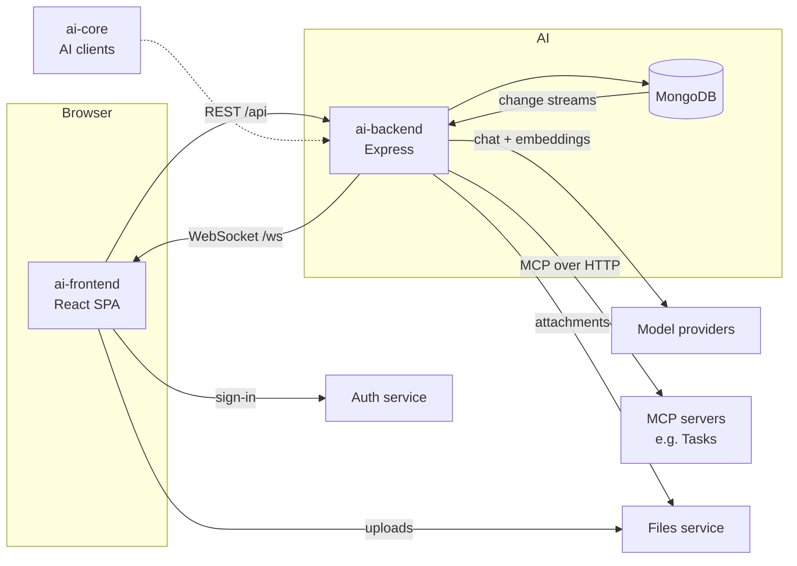

# AI

An AI chat assistant that works with models from many providers. It remembers what matters about you across conversations, takes file and image attachments, and connects to MCP servers so the model can use tools from your other apps.

**Live:** [ai.olegpoliakov.dev](https://ai.olegpoliakov.dev)

<!-- TODO: add a screenshot, e.g.  -->

## Repositories

This is an overview repository. The code lives in three repositories, one per layer:

| Repository | Package | What it is |
|---|---|---|
| [ai-core](https://github.com/olegpolyakov/ai-core) | `@olegpolyakov/ai-core` | A provider-agnostic AI client: one interface over OpenAI-compatible, Anthropic, and Ollama APIs, with a tool-calling loop. Published to GitHub Packages. |
| [ai-backend](https://github.com/olegpolyakov/ai-backend) | `@olegpolyakov/ai-backend` | Node.js service: REST API, WebSocket change feed, long-term memory, and an MCP client for integrations. Deployed as its own container. |
| [ai-frontend](https://github.com/olegpolyakov/ai-frontend) | `@olegpolyakov/ai-frontend` | React single-page app served by nginx. Deployed as its own container. |

## Features

- **Conversations** whose titles are generated from the first exchange, with unread counts, plus editing and deleting of messages
- **Quick response**: a one-off answer without saving a conversation
- **Model choice**: pick a model per conversation from many providers (OpenAI, Anthropic, Gemini, DeepSeek, xAI, Moonshot, and more)
- **Attachments**: send files and images with a message
- **Long-term memory**: facts, preferences, and goals are extracted from conversations and recalled when relevant
- **Integrations**: connect MCP servers and the model can call their tools
- **Real-time sync**: messages and conversation changes appear on every open device
- **Guest mode**: try the app without an account; data stays in the browser session and replies are canned demo responses

## Architecture

- **ai-core** hides the differences between provider SDKs behind one `AIClient` class. Each client turns the shared message format (text, images, files) into its provider's format. Each client also runs the tool-calling loop: it calls the model, runs any requested tools, and sends the results back until the model gives a final answer.
- **ai-backend** serves two interfaces from one process:
  - `/api`: REST endpoints for conversations and their messages, quick responses, models, memories, integrations, and embeddings
  - `/ws`: a WebSocket feed. MongoDB change streams detect new and updated conversations and messages, and the backend pushes them to the user's connected clients.
- **ai-frontend** is organized by feature (`chat`, `messages`, `respond`, `models`, `memories`, `integrations`, `settings`). Each feature has its own API client, hooks, and components. Features that talk to the backend have both a remote API client and an in-memory one, and guest mode switches to the in-memory client.
- **Shared platform:** AI is one of several apps built on the same shared packages: `@olegpolyakov/core`, `backend`, `frontend`, and `ui` (component library). Sign-in is handled by a separate auth service and file storage by a separate files service.

## How a reply is built

When the user sends a message, the backend:

1. Saves the message and loads the last 25 messages of the conversation.
2. Builds a system prompt from the user's stored preferences and the memories most relevant to the new message.
3. Resolves attachments: the files service supplies each file's content, which goes to the model as a file or image.
4. Collects tools from the user's enabled MCP integrations.
5. Calls the conversation's model and saves the reply. Both messages reach the client over the WebSocket feed.
6. Extracts new memories from the exchange in the background.

## Memory

- After each message, the model extracts long-term facts as structured JSON. Each fact has a type (`preference`, `goal`, `project`, `skill`, `fact`, or `relationship`), an importance from 1 to 10, and a confidence from 0 to 1.
- Each memory is stored with an embedding. A new memory that is more than 90% similar to an existing one of the same type counts as a repeat. Repeats aren't added; instead the existing memory's confidence goes up.
- Preferences are always added to the prompt. Other memories are ranked by similarity to the message (65%), importance (15%), confidence (15%), and how recently they were used (5%), and the top 5 are added. Memories below 0.5 confidence are never used.
- Memories can be reviewed and deleted in the app's settings.

## Integrations

- An integration is the URL of an MCP server that uses streamable HTTP.
- The backend connects with the user's own JWT, so an MCP server on the same platform, such as the [Tasks](https://github.com/olegpolyakov/tasks) app, sees the request as coming from that user and gives access to that user's data only.
- Tools from all enabled integrations go to the model on every reply. If one server can't be reached, the backend logs the error and uses the tools from the rest.

## Tech stack

| Layer | Technologies |
|---|---|
| Frontend | TypeScript, React 19, React Router, Sass, Vite |
| Backend | TypeScript, Node.js, Express, MongoDB (Mongoose), WebSocket (`ws`), MCP SDK |
| AI | OpenAI SDK, Anthropic SDK, Ollama |
| Testing | Vitest |
| Infrastructure | Docker, nginx, GitHub Packages |
